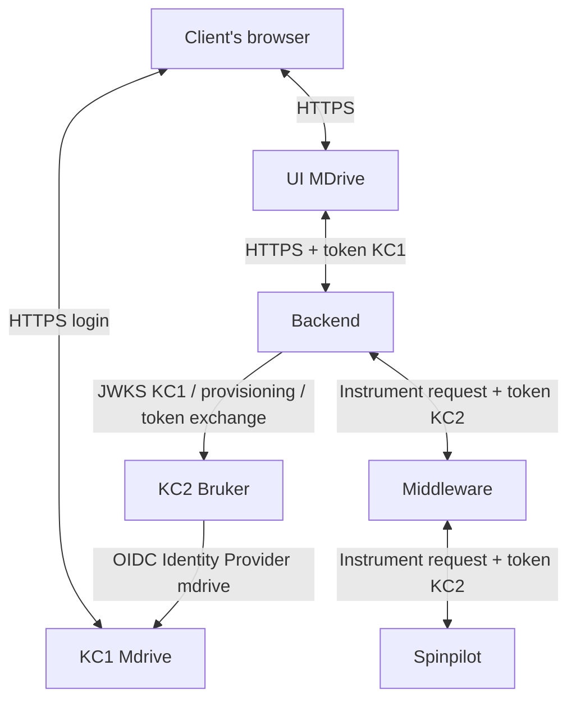

# Análisis para un entorno real

## 1. Arquitectura objetivo

MDrive se instala en el servidor de Mestrelab junto con su UI, KC1, backend y
middleware. KC2 y Spinpilot se instalan fuera de esta composición en el
servidor de Bruker/Topspin.

El navegador usa KC1 como único punto de entrada de identidad de MDrive. KC1
autentica al usuario y emite el token para el frontend. KC2 mantiene a KC1 como
Identity Provider para validar el token durante el provisioning y el exchange.
Sólo el backend obtiene el token KC2 necesario para Spinpilot.

## 2. Flujo operativo

1. El usuario inicia sesión en MDrive mediante KC1.
2. KC1 emite el token de MDrive.
3. El backend valida el token KC1 y aplica autorización.
4. El backend extrae `preferred_username` y `sub`.
5. El backend busca el mismo username en KC2 y crea o verifica el enlace
   federado `mdrive` mediante el cliente provisioner.
6. El backend solicita a KC2 un token exchange legacy con
   `subject_issuer=mdrive`.
7. El backend entrega el token KC2 al middleware.
8. El middleware valida y propaga el token a Spinpilot.

El backend usa un cliente provisioner separado y de mínimo privilegio para la
Admin API de KC2. El provisioning es idempotente y se basa en username y `sub`.
El middleware no realiza exchange ni provisioning.

Los clientes y valores funcionales del realm `Bruker` son:

| Función | Client ID / valor |
| --- | --- |
| Broker de KC2 hacia KC1 | `kc2-to-kc1-idp` |
| Token exchange del backend | `mdrive-backend-token-exchange` |
| Provisioning Admin API | `mdrive-backend-provisioner` |
| Audience Spinpilot | `TopSpinAutomation` |
| Alias del IdP | `mdrive` |

El cliente `TopSpinAutomation-rights` puede aparecer como `azp` y como recurso
con roles en un token válido, pero la audience de la API es
`TopSpinAutomation`.

## 3. Requisitos de red

| Origen | Destino | Propósito |
| --- | --- | --- |
| Navegador | UI y KC1 | Aplicación y login |
| KC2 | KC1 | Identity Provider OIDC, discovery y JWKS |
| Backend | KC1 | Validación de tokens y JWKS |
| Backend | KC2 | Provisioning de enlaces y token exchange |
| Backend | Middleware | Operación interna y token KC2 |
| Middleware | KC2 | Validación JWT/JWKS |
| Middleware | Spinpilot | API protegida |

No se deben publicar APIs administrativas, puertos de base de datos ni
endpoints internos del backend o middleware. Los timeouts, reintentos y
circuit breakers deben diferenciar operaciones idempotentes de operaciones que
modifican el instrumento.

## 4. Certificados

- El proxy proporciona TLS público para UI y KC1.
- KC1 y middleware necesitan la CA de Bruker para las conexiones a KC2.
- El backend necesita [`certs/MestrelabCA.crt`](/home/jrial/Documents/POCs/mdrive-frontend+keycloak1+keycloak2/certs/MestrelabCA.crt)
  para KC1.
- El middleware necesita [`certs/root_ca_bruker.crt`](/home/jrial/Documents/POCs/mdrive-frontend+keycloak1+keycloak2/certs/root_ca_bruker.crt)
  para KC2 y Spinpilot.
- La JVM de KC2 necesita la CA de KC1 en su truststore global. El servicio
  `Bruker_Keycloak` se ejecuta mediante NSSM y debe utilizar la misma
  configuración que se comprueba con `show-config`.

Los truststores por servicio deben conservar las CAs Java por defecto y añadir
sólo las CAs privadas necesarias. Las claves privadas y las CAs no deben
incluirse en la imagen ni en el repositorio salvo que la política de despliegue
lo exija explícitamente.

El navegador debe confiar en la CA que firma los certificados públicos de UI,
KC1 y, durante el login federado, KC2. No se debe pedir al usuario que ignore
advertencias TLS.

## 5. Seguridad de identidad

KC2 debe restringir el Identity Provider `mdrive`, el cliente
`mdrive-backend-token-exchange` y el cliente provisioner
`mdrive-backend-provisioner`. El token exchange debe estar limitado al alias
`mdrive`, a la audience `TopSpinAutomation` y al uso previsto por Spinpilot.
El provisioner sólo debe poder
consultar usuarios y crear enlaces federados.

En los permisos de token exchange del cliente `TopSpinAutomation` debe existir
una política que autorice a `mdrive-backend-token-exchange`.

KC2 debe controlar qué audience, scopes y roles aparecen en el token externo.
Spinpilot debe validar issuer, firma, expiración y audience y registrar la
identidad individual del usuario.

La configuración debe definir qué ocurre si KC2 o Spinpilot no están
disponibles: el login local y las funciones locales de MDrive pueden continuar,
pero las operaciones que requieran el instrumento deben fallar cerrado con un
error operativo claro.

## 6. Secretos y auditoría

Los secretos de `mdrive-backend-token-exchange`, `mdrive-backend-provisioner`,
administradores y
truststores deben inyectarse mediante secretos de despliegue y rotarse. No se
deben usar credenciales `admin/admin` en producción.

Los logs deben incluir correlation ID, usuario, operación, resultado y tiempos,
pero nunca access tokens, secretos o JWT completos. Los cambios de permisos de
KC1, las operaciones de token exchange y los errores de validación deben quedar
auditados.

## 7. Disponibilidad y aceptación

Antes de producción hay que probar:

- login local y login federado;
- usuario local rechazado para Spinpilot;
- usuario federado autorizado con token KC2 individual;
- audience y scopes aceptados por Spinpilot;
- token exchange rechazado con cliente, issuer o audience incorrectos;
- expiración y rotación de certificados;
- caída de KC2 y de Spinpilot;
- rotación de claves y recuperación de KC1;
- ausencia de tokens en logs y frontend.

KC1 en modo `start-dev`, las credenciales de prueba y la visualización del JWT
son recursos de PoC y deben eliminarse o sustituirse antes de producción.
