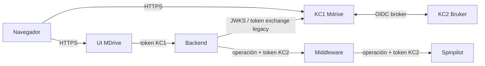

# Análisis para un entorno real

## 1. Arquitectura objetivo

MDrive se instala en el servidor de Mestrelab junto con su UI, KC1, backend y
middleware. KC2 y Spinpilot se instalan fuera de esta composición en el
servidor de Bruker/Topspin.

El navegador usa KC1 como único punto de entrada de identidad de MDrive. KC1
puede redirigirlo a KC2 para autenticar usuarios de Bruker. El navegador y el
backend reciben inicialmente un token de KC1; sólo el backend obtiene el token
KC2 necesario para Spinpilot.

## 2. Flujo operativo

1. El usuario inicia sesión en MDrive mediante KC1.
2. Para un usuario externo, KC1 usa el IdP OIDC `topspin` y completa el login
   contra KC2.
3. KC1 emite el token de MDrive y almacena el token externo de KC2.
4. El backend valida el token KC1 y aplica autorización.
5. Para una operación de instrumento, el backend exige `auth_source=topspin`.
6. El backend solicita a KC1 un token exchange legacy con
   `requested_issuer=topspin`.
7. El backend entrega el token KC2 al middleware.
8. El middleware valida y propaga el token a Spinpilot.

El backend no usa la Admin API de KC2, no busca usuarios por username/email y
no crea enlaces federados durante una operación. El middleware tampoco realiza
exchange ni provisioning.

## 3. Requisitos de red

| Origen | Destino | Propósito |
| --- | --- | --- |
| Navegador | UI y KC1 | Aplicación y login |
| KC1 | KC2 | Broker OIDC |
| Backend | KC1 | JWKS y token exchange |
| Backend | Middleware | Operación interna y token KC2 |
| Middleware | KC2 | Validación JWT/JWKS |
| Middleware | Spinpilot | API protegida |

No se deben publicar APIs administrativas, puertos de base de datos ni
endpoints internos del backend o middleware. Los timeouts, reintentos y
circuit breakers deben diferenciar operaciones idempotentes de operaciones que
modifican el instrumento.

## 4. Certificados

- El proxy proporciona TLS público para UI y KC1.
- KC1 y middleware necesitan la CA de Bruker para las conexiones a KC2.
- El backend necesita [`certs/MestrelabCA.crt`](/home/jrial/Documents/POCs/mdrive-frontend+keycloak1+keycloak2/certs/MestrelabCA.crt)
  para KC1.
- El middleware necesita [`certs/root_ca_bruker.crt`](/home/jrial/Documents/POCs/mdrive-frontend+keycloak1+keycloak2/certs/root_ca_bruker.crt)
  para KC2 y Spinpilot.

Los truststores por servicio deben conservar las CAs Java por defecto y añadir
sólo las CAs privadas necesarias. Las claves privadas y las CAs no deben
incluirse en la imagen ni en el repositorio salvo que la política de despliegue
lo exija explícitamente.

El navegador debe confiar en la CA que firma los certificados públicos de UI,
KC1 y, durante el login federado, KC2. No se debe pedir al usuario que ignore
advertencias TLS.

## 5. Seguridad de identidad

KC1 debe restringir el IdP `topspin`, las redirect URIs, scopes y permisos del
cliente `app1-middleware`. El token exchange debe estar limitado al issuer
`topspin` y al uso previsto por Spinpilot.

KC2 debe controlar qué audience, scopes y roles aparecen en el token externo.
Spinpilot debe validar issuer, firma, expiración y audience y registrar la
identidad individual del usuario.

La configuración debe definir qué ocurre si KC2 o Spinpilot no están
disponibles: el login local y las funciones locales de MDrive pueden continuar,
pero las operaciones que requieran el instrumento deben fallar cerrado con un
error operativo claro.

## 6. Secretos y auditoría

Los secretos de `app1-middleware`, `mdrive-broker`, administradores y
truststores deben inyectarse mediante secretos de despliegue y rotarse. No se
deben usar credenciales `admin/admin` en producción.

Los logs deben incluir correlation ID, usuario, operación, resultado y tiempos,
pero nunca access tokens, secretos o JWT completos. Los cambios de permisos de
KC1, las operaciones de token exchange y los errores de validación deben quedar
auditados.

## 7. Disponibilidad y aceptación

Antes de producción hay que probar:

- login local y login federado;
- usuario local rechazado para Spinpilot;
- usuario federado autorizado con token KC2 individual;
- audience y scopes aceptados por Spinpilot;
- token exchange rechazado con cliente, issuer o audience incorrectos;
- expiración y rotación de certificados;
- caída de KC2 y de Spinpilot;
- rotación de claves y recuperación de KC1;
- ausencia de tokens en logs y frontend.

KC1 en modo `start-dev`, las credenciales de prueba y la visualización del JWT
son recursos de PoC y deben eliminarse o sustituirse antes de producción.
