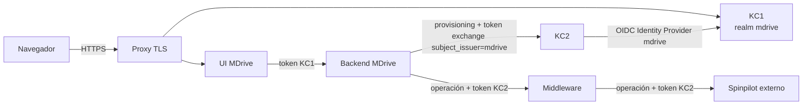

# Análisis de la arquitectura MDrive / Spinpilot

## 1. Topología implementada



Docker Compose ejecuta `frontend`, `keycloak1`, `backend` y `middleware` en la
red `server1`. KC2 y Spinpilot están instalados fuera de la composición.

URLs públicas actuales:

| Servicio | URL |
| --- | --- |
| UI | `https://mdrive2-poc-ui.mestrelab.local` |
| KC1 | `https://mdrive2-poc-keycloak.mestrelab.local` |
| KC2 | `https://mdrive-topspin50-win-dev.mestrelab.local:8443` |
| Spinpilot | `https://mdrive-topspin50-win-dev.mestrelab.local:8017` |

## 2. Responsabilidades

### KC1

KC1 es el issuer de MDrive. Emite el token que consume el frontend. KC1 no
actúa como broker hacia KC2.

### Backend

El backend valida tokens KC1, aplica autorización de negocio, garantiza el
enlace federado en KC2 y realiza el token exchange contra KC2. El vínculo se
basa en `preferred_username` de KC1 y `username` de KC2, guardando el `sub` de
KC1 como identidad externa. Usa un cliente provisioner separado y de mínimo
privilegio para la Admin API de KC2.

### Middleware

El middleware recibe el token KC2 obtenido por el backend, lo valida contra KC2
y lo propaga a Spinpilot. No realiza token exchange ni gestiona identidades.

### Spinpilot

Spinpilot valida el token emitido por KC2, incluida su firma, issuer, expiración
y audience, y ejecuta la operación sobre el instrumento.

La audience validada en el flujo actual es:

```text
TopSpinAutomation
```

El cliente `TopSpinAutomation-rights` representa el cliente autorizado (`azp`)
en un token válido, pero no sustituye a la audience de la API.

## 3. Flujo de autenticación

### Usuario local de KC1

1. El usuario inicia sesión directamente en KC1.
2. KC1 emite un token para MDrive.
3. El frontend lo envía al backend.
4. El backend valida firma, issuer, audience y claims.
5. Las operaciones locales de MDrive continúan disponibles.
6. Las operaciones contra Spinpilot se rechazan o se marcan como no aplicables.

### Usuario de KC1 con acceso a KC2

1. El usuario inicia sesión directamente en KC1.
2. KC1 emite un token KC1 para el frontend.
3. El backend valida el token y extrae `preferred_username` y `sub`.
4. El backend busca el mismo username en KC2.
5. El backend crea o verifica el enlace federado `mdrive` mediante el cliente
   provisioner.
6. El backend llama al endpoint de token de KC2 usando el token KC1 como
   `subject_token`, `subject_issuer=mdrive` y `audience=TopSpinAutomation`.
7. KC2 emite el token KC2.
8. El backend envía el token KC2 al middleware.
9. El middleware valida y reenvía ese token a Spinpilot.

El frontend nunca recibe el token final de KC2. La renovación del token externo
no se debe asumir indefinida: si KC1 no puede devolver un token válido, puede
ser necesario repetir el login federado.

## 4. Confianza TLS

La terminación TLS pública de UI y KC1 la realiza el proxy. Los contenedores
Java necesitan confianza adicional para los servidores externos:

| Componente | Conexiones HTTPS | CA adicional |
| --- | --- | --- |
| Backend | KC1 y KC2 | `certs/MestrelabCA.crt` y `certs/root_ca_bruker.crt` |
| Middleware | KC2 y Spinpilot | `certs/root_ca_bruker.crt` |
| KC1 | KC2 durante el broker | `certs/root_ca_bruker.crt` |

KC2, que se ejecuta como servicio Windows mediante NSSM, debe tener la CA de
KC1 en el truststore utilizado por la JVM del servicio. La propiedad
`truststore-paths` debe apuntar a la CA o a un JKS que la contenga. El
truststore del `Truststore SPI` por sí solo no garantiza que el cliente HTTP
que descarga los JWKS lo utilice.

Cada Dockerfile parte del truststore Java por defecto para no perder CAs
públicas y añade sólo la CA que necesita ese servicio.

## 5. Autorización y auditoría

La autorización para usar instrumentos se decide en el backend antes de
contactar con el middleware. Los usuarios locales no deben generar llamadas a
KC2, middleware o Spinpilot para esa operación.

El token KC2 debe conservar la identidad individual del usuario y contener la
audience aceptada por Spinpilot. No se debe sustituir por un token técnico si se
requiere trazabilidad por usuario.

No se deben registrar access tokens, secretos ni JWT completos. Los logs deben
usar un identificador de correlación y registrar usuario, operación, resultado
y timestamps según la política de auditoría aplicable.

## 6. Límites y riesgos conocidos

- El token exchange legacy de KC2 es una dependencia de compatibilidad y debe
  estar restringido a `mdrive-backend-token-exchange` y al IdP `mdrive`.
- El cliente provisioner de KC2 tiene privilegios elevados y debe separarse del
  cliente de token exchange, limitarse a usuarios/enlaces y auditarse.
- La renovación automática del token externo de KC2 no está garantizada.
- KC2 y Spinpilot son dependencias externas; deben configurarse timeouts,
  errores explícitos y circuit breakers para operaciones no idempotentes.
- Los secretos y credenciales de la PoC son sólo de desarrollo.
- La configuración `start-dev` de KC1 no es una configuración productiva.
- El endpoint de depuración de la UI que muestra el JWT debe eliminarse antes
  de producción.
- El servicio de KC2 debe poder descargar los JWKS de KC1; si aparece
  `PKIX path building failed`, el token exchange fallará como
  `invalid_token` aunque el JWT sea correcto.

## 7. Validaciones

Se han validado `docker compose config`, los tests Maven de backend y
middleware, la sintaxis de scripts, `git diff --check` y la construcción de
las imágenes. La validación funcional realizada cubre login KC1, provisioning
idempotente, token exchange KC2, propagación al middleware y llamada real a
Spinpilot.
