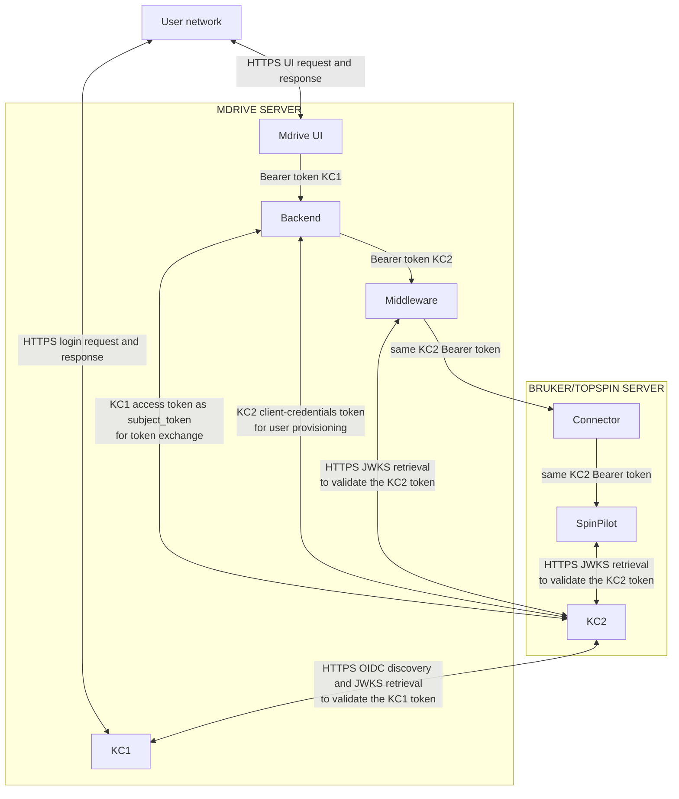

# Mdrive 2 & Topspin 5/SpinPilot integration

## Table of contents

- [Introduction](#introduction)
- [Objective](#objective)
- [Requirements](#requirements)
- [Architecture](#architecture)
- [Current endpoints](#current-endpoints-poc)
- [Keycloak configuration](#keycloak-configurations)
- [Certificates and trust](#certificates-and-trust)
- [Username-only federation](#username-only-federation)
- [Multiple SpinPilot installations](#extending-the-architecture-to-multiple-spinpilot-installations)
- [Problems and limitations](#identified-problems-and-limitations)
- [Acceptance tests](#acceptance-tests)

Author: Frco. Javier Rial Rodriguez <f.rial_rodriguez@sciy.com>

## Introduction

This document describes the implemented proof of concept and the architecture required for a production integration.

## Objective

The objective is to integrate Mdrive 2.0 with Topspin 5/SpinPilot so that a user authenticated through Mdrive can execute operations on an instrument while SpinPilot receives the individual Bruker user identity for GxP traceability.

Mdrive remains usable for local operations when the external Bruker services are unavailable.

Instrument operations will fail when the required identity, token or SpinPilot service is unavailable.

## Requirements

- Mdrive has its own Keycloak (KC1) and does not depend on KC2 (from the Topspin 5/SpinPilot installation) for local Mdrive functionality.
- KC1 is the only identity provider known by the Mdrive frontend.
- KC2 configures KC1 as its OIDC Identity Provider with alias mdrive. The Mdrive frontend authenticates only against KC1.
- The backend validates the KC1 token, verifies the matching username in KC2, provisions the federated link and performs the token exchange.
- The middleware just receives the exchanged token from the backend, forwards it to the connector, and the connector makes the request to SpinPilot and returns the output to the middleware.
- SpinPilot receives a user token issued by KC2, not a generic technical token, so the individual user remains traceable.
- Users authenticated locally in KC1 may use Mdrive but are not allowed to invoke SpinPilot operations

## Architecture

The implemented architecture uses KC1 as the Mdrive token issuer. KC2, deployed with TopSpin/SpinPilot, acts as the external authorization server and issues the token used to access SpinPilot. KC2 is configured with KC1 as the mdrive OIDC Identity Provider, and the Mdrive backend performs the token exchange directly against KC2.

### Network zones

There are three relevant network zones:

- Users network: the network where end-user computers are located
- Mdrive network: where Mdrive solution will be deployed
- Instrument network: where the Topspin/Spinpilot solution will be deployed

and two different servers: Mdrive server and Bruker/Topspin server

KC1, the Mdrive UI, backend and middleware are deployed on the Mdrive server.

KC2 and SpinPilot are deployed externally on the Bruker/Topspin server.
Also, in this server, we will install our connector which will receive the requests from the Middleware.

User computers must have access to the Mdrive network (or to the ports where the Mdrive components are listening), and the Mdrive server must have access to the Instruments network (or to the ports where the Topspin/SpinPilot are listening)
Connections from KC1 and the middleware to Bruker services use HTTPS and the Bruker CA.

User computers must be able to reach the externally exposed Mdrive UI, backend and KC1 endpoints.

The Mdrive backend must be able to establish the required HTTPS connections to KC1 and KC2, and the middleware must be able to reach KC2 and SpinPilot on their configured ports.

KC2 must also be able to reach KC1 for OIDC discovery and JWKS retrieval.

All HTTPS connections to services using private certificates require the corresponding trusted CA to be installed in the component initiating the connection.

### Current flow

- The browser authenticates directly against KC1. KC1 issues the token consumed by the Mdrive frontend.
- KC1 does not store a KC2 token. The backend obtains a KC2 token only when an instrument operation is requested.
- The backend validates the KC1 token and extracts preferred_username and sub before an instrument operation.
- The backend provisions or verifies the KC2 federated link and requests a legacy token exchange directly from KC2 with subject_issuer=mdrive and audience=TopSpinAutomation.
- KC2 validates the KC1 subject token and returns a KC2 token for the TopSpinAutomation audience.
- The backend sends the operation and KC2 token to the internal middleware.
- The middleware validates the KC2 token and forwards the same bearer token to SpinPilot.

### Network topology and token flow

## Current endpoints (POC)

- Mdrive UI: https://mdrive2-poc-ui.mestrelab.local
- Mdrive KC1: https://mdrive2-poc-keycloak.mestrelab.local
- External KC2: https://mdrive-topspin50-win-dev.mestrelab.local:8443/auth/realms/Bruker
- External SpinPilot: https://mdrive-topspin50-win-dev.mestrelab.local:8017
- Mdrive backend and middleware: internal Docker services on port 8080.

## Keycloak configurations

### KC1

Create the following confidential client in KC1:
- Client ID: kc2-to-kc1-idp.
- Client authentication: On.
- Standard flow: On.
- Direct access grants: Off.
- Redirect URI: https://mdrive-topspin50-win-dev.mestrelab.local:8443/auth/realms/Bruker/broker/mdrive/endpoint.
- The client secret must match the secret configured in the KC2 Identity Provider mdrive.

The frontend client in KC1 must have an audience mapper that includes kc2-to-kc1-idp in the access token. KC2 uses this audience when validating the KC1 subject token.

### KC2

#### KC2 Identity Provider configuration

In the KC2 realm Bruker, configure the following OpenID Connect Identity Provider:
- Alias: mdrive.
- Client ID: kc2-to-kc1-idp.
- Client authentication: Client secret created on KC1.
- Validate signatures: On.
- Use JWKS URL: On.
- Hide on login page: On.
- Issuer: https://mdrive2-poc-keycloak.mestrelab.local/realms/mdrive.
- JWKS URL: https://mdrive2-poc-keycloak.mestrelab.local/realms/mdrive/protocol/openid-connect/certs.
- Authorization URL: https://mdrive2-poc-keycloak.mestrelab.local/realms/mdrive/protocol/openid-connect/auth.
- Token URL: https://mdrive2-poc-keycloak.mestrelab.local/realms/mdrive/protocol/openid-connect/token.
- User Info URL: https://mdrive2-poc-keycloak.mestrelab.local/realms/mdrive/protocol/openid-connect/userinfo.

The `Hide on login page` option only removes the `mdrive` login option from
the KC2 login page. The Identity Provider must remain enabled because KC2
requires it to validate the `subject_issuer=mdrive` token exchange and the
federated identity link. Hiding the provider is not a security boundary;
users should not be given direct access to the KC2 login interface.

#### KC2 token-exchange client

Create the following confidential client in the KC2 realm Bruker:
- Client ID: mdrive-backend-token-exchange.
- Client authentication: On.
- Standard flow: Off.
- Direct access grants: Off.
- Service accounts: Off.
The backend calls the KC2 token endpoint with grant_type=token-exchange, subject_issuer=mdrive and audience=TopSpinAutomation.

#### KC2 SpinPilot target client and permissions

- Target client / audience: TopSpinAutomation.
- A valid SpinPilot token contains aud=TopSpinAutomation and azp=TopSpinAutomation-rights.
- Enable token-exchange permissions on TopSpinAutomation.
- Create a Client Policy authorizing mdrive-backend-token-exchange.

If the target client is missing, KC2 returns Audience not found. If the policy is missing, KC2 returns Client not allowed to exchange.

#### KC2 provisioning client

Create a separate confidential client for the KC2 Admin API:
- Client ID: mdrive-backend-provisioner.
- Client authentication: On.
- Service accounts: On.
- Standard flow: Off.
- Direct access grants: Off.
- Use a separate secret from the token-exchange client.
- Grant only the user lookup and federated-link permissions required by the deployed KC2 version: Grant the following Service accounts roles: manage-users, view-users, query-users

The backend uses this client to find exactly one KC2 user by username, inspect existing federated identities and create the mdrive federated link when it is missing. It does not create KC2 users and rejects ambiguous or inconsistent links.

## Certificates and trust

- End user computers must trust the Mestrelab CA.
- KC1 trusts the Bruker CA for its HTTPS connection to KC2.
- The middleware trusts the Bruker CA for KC2 and SpinPilot.
- The backend trusts the Mestrelab CA for KC1 and the Bruker CA for KC2. The KC2 service Bruker_Keycloak must use a truststore containing the Mestrelab CA.

## Username-only federation

The KC2 user record may provide only a username (as Bruker IAM only requires a username). The current integration therefore does not require email, first name, or last name to establish the instrument identity.

Before requesting a token from KC2, the Mdrive backend performs an exact lookup of the KC2 user whose username matches the `preferred_username` claim from the KC1 token. Exactly one matching KC2 user must exist. The backend does not create the user in KC2; if the user does not exist, or if the username is ambiguous, the instrument operation is rejected.

For an existing user, the backend creates or verifies the federated identity link in KC2 using the `mdrive` Identity Provider alias and the KC1 `sub` claim. This operation is idempotent and must reject inconsistent existing links rather than overwrite them.

## Extending the architecture to multiple SpinPilot installations

The current PoC supports a single KC2 and SpinPilot installation. The same architecture can be extended to multiple installations, but each installation must have an explicit, server-side configuration entry. This implies a lot of manual configurations on the Keycloaks and that the backend must be able to handle several KC2s installations and use the right one. It’s out of the scope of this document to analyze this implementation on the backend side.

For each external KC2/SpinPilot installation:

- Configure KC1 as an OIDC Identity Provider in the corresponding KC2.
- Configure a unique Identity Provider alias in that KC2, such as `mdrive-a` or `mdrive-b`. The value is used as the `subject_issuer` during token exchange.
- Create a dedicated OIDC client in KC1 for that KC2 to use as its broker client, with its own client ID, secret, and redirect URI.
- Create a dedicated token-exchange client in the target KC2, together with the required token-exchange permissions.
- Define the target KC2 issuer, token endpoint, JWKS endpoint, audience, middleware endpoint, and SpinPilot URL.
- Configure the required CA and truststore for every connection in the installation.

The backend must select the installation from a server-side allow-list. The browser must never provide an arbitrary issuer, token endpoint, audience, middleware URL, or SpinPilot URL.

The selected installation determines all external endpoints and credentials.
A token obtained for installation A must never be sent to installation B.
Provisioning and federated links must also be evaluated in the context of the selected installation.

The initial account lookup may use the KC1 `preferred_username` to locate the corresponding KC2 user. The stable identity must then be represented by the KC1 issuer and subject, together with the installation context where required.

The current implementation is single-instance and would require a configuration model, installation selection logic, isolated credentials, and separate trust boundaries before supporting multiple installations.

## Identified problems and limitations

- The legacy token exchange feature and fine-grained authorization are compatibility dependencies of the current KC1 version.
- KC2 access tokens are short-lived. The current backend requests a new KC2 token exchange for each instrument operation and does not depend on indefinite token renewal. Long-running or multi-step operations must handle token expiration explicitly and report re-exchange failures.
- Bruker BioSpin IAM allows to create users without email, firstname and lastname. So we can only relay on a “username” field and that’s the only info available for Mdrive to match users between our Keycloak and Bruker’s one
- End-to-end error tracing is critical because an instrument operation crosses several components and network boundaries: the browser, KC1, backend, KC2, middleware, connector and SpinPilot. Each application should support configurable `DEBUG` logging so that authentication, provisioning, token exchange, forwarding and downstream failures can be diagnosed independently.
- Debug logging should be disabled by default in production. Logs should use a shared correlation or request ID across the complete operation and must redact access tokens, client secrets, passwords and other sensitive identity data.

## Acceptance tests

- Local KC1 login succeeds and local Mdrive operations remain available.
- Local KC1 user requests to instruments are rejected by the backend.
- A KC2 user can complete the brokered login using only username.
- The backend receives a KC1 token, provisions the KC2 link and obtains a KC2 token through direct KC2 exchange.
- The middleware accepts the KC2 token and forwards this token to the connector to use it to authenticate within SpinPilot which receives the individual user identity.
- Incorrect client, issuer, audience and expired-token cases fail closed.
- KC2 or SpinPilot outages return controlled errors without preventing local Mdrive use.
